<picture>
  <source media="(prefers-color-scheme: dark)" srcset="assets/header-dark.svg">
  
</picture>

<br>

I build software around AI agents: the tools that keep them in check, the assistants that run on your own machine, and the interfaces people actually see. 21, CS student, ships on weekends.

```text
$ whoami --verbose
  focus     agent orchestration · NLP · RAG · local-first AI
  building  Branchglance · SmartAlexa
  stack     Python · TypeScript · C++ · PyTorch · Next.js · Three.js
  off-hours photography · cinematography · music × AI
```

## Selected work

| Project | What it is | Stack |
|---|---|---|
| **[Branchglance](https://github.com/apratxxm/branchglance)** | Always-on-top Windows widget for Codex and Claude Code: every agent in one tree, which ones need you, and how much of your usage limits is left. | Python |
| **[SmartAlexa](https://github.com/apratxxm/smartalexa)** | Local-first voice assistant for Windows: wake word, on-device models, Spotify and desktop control behind explicit permission gates. | Python · Ollama |
| **[Visotonics 3D](https://github.com/apratxxm/visotonics3d)** | Cinematic scroll site: one shipping container followed through an AI inspection facility in a single pinned WebGL scene. | Next.js · R3F · GSAP |
| **[JobAngel](https://github.com/apratxxm/jobangel)** | Internship outreach engine: scrapes startups and writes personalised cold emails with RAG. | Python · RAG |
| **[de-mistifi](https://github.com/apratxxm/de-mistifi)** | Turns raw chat history into structured project knowledge bases. | Python · LLMs |

## Toolkit

<p>
  
</p>

## Activity

<picture>
  <source media="(prefers-color-scheme: dark)" srcset="https://raw.githubusercontent.com/apratxxm/apratxxm/output/snake-dark.svg">
  
</picture>

## Contact

<a href="mailto:apratxmwork@gmail.com"></a>
<a href="https://www.linkedin.com/in/apratimpandey"></a>

Open to **AI/ML and software engineering internships**.
