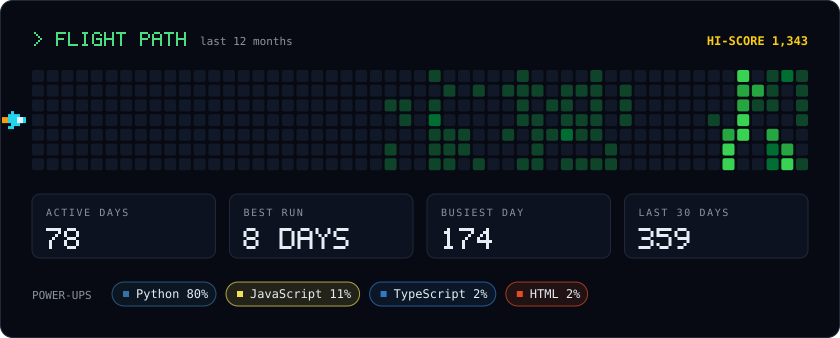
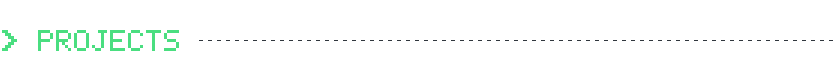
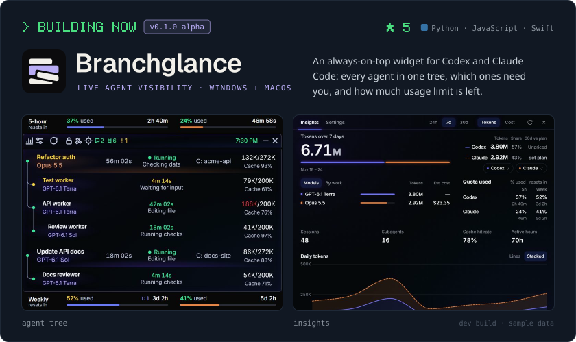
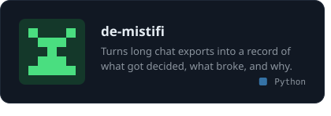
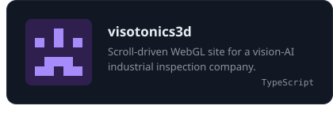
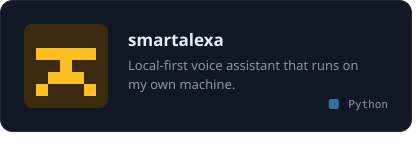
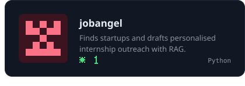
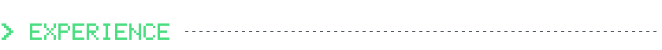
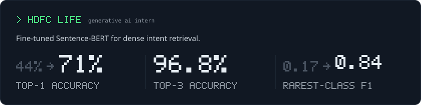

<a href="https://github.com/apratxxm/branchglance/releases/tag/v0.1.0">branchglance alpha</a> · <a href="https://www.linkedin.com/in/apratimpandey">linkedin</a> · <a href="mailto:apratxmwork@gmail.com">email</a>

